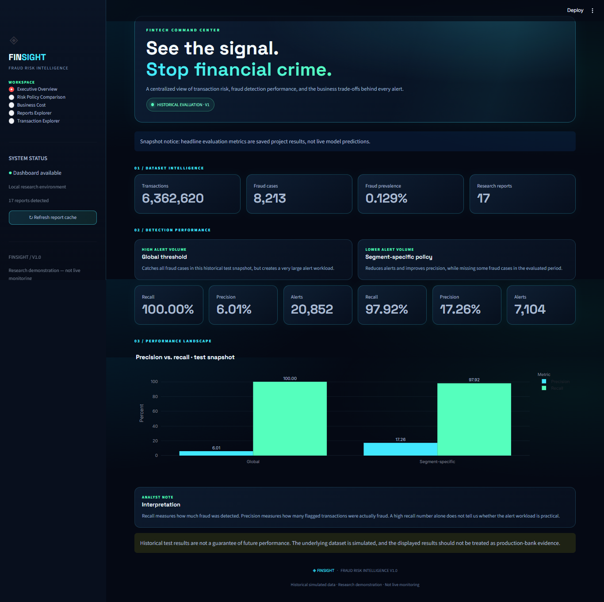
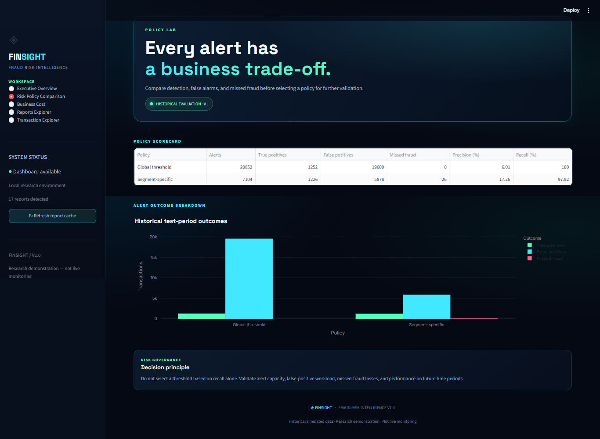
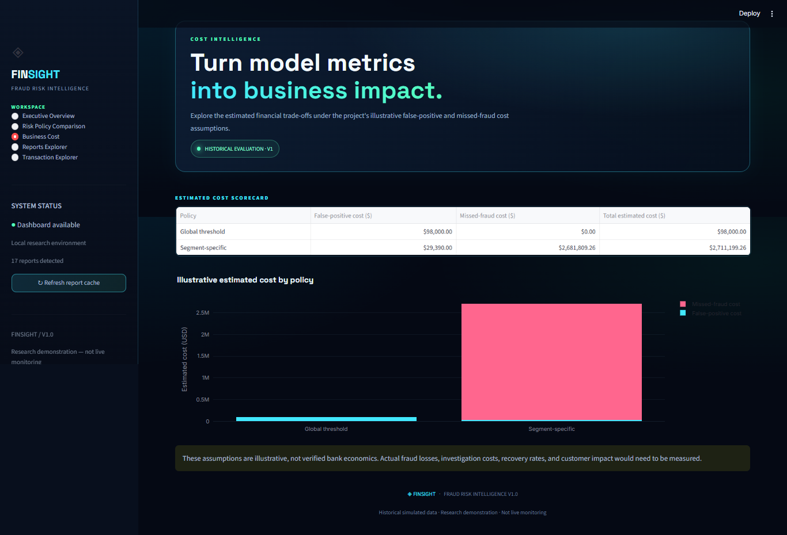
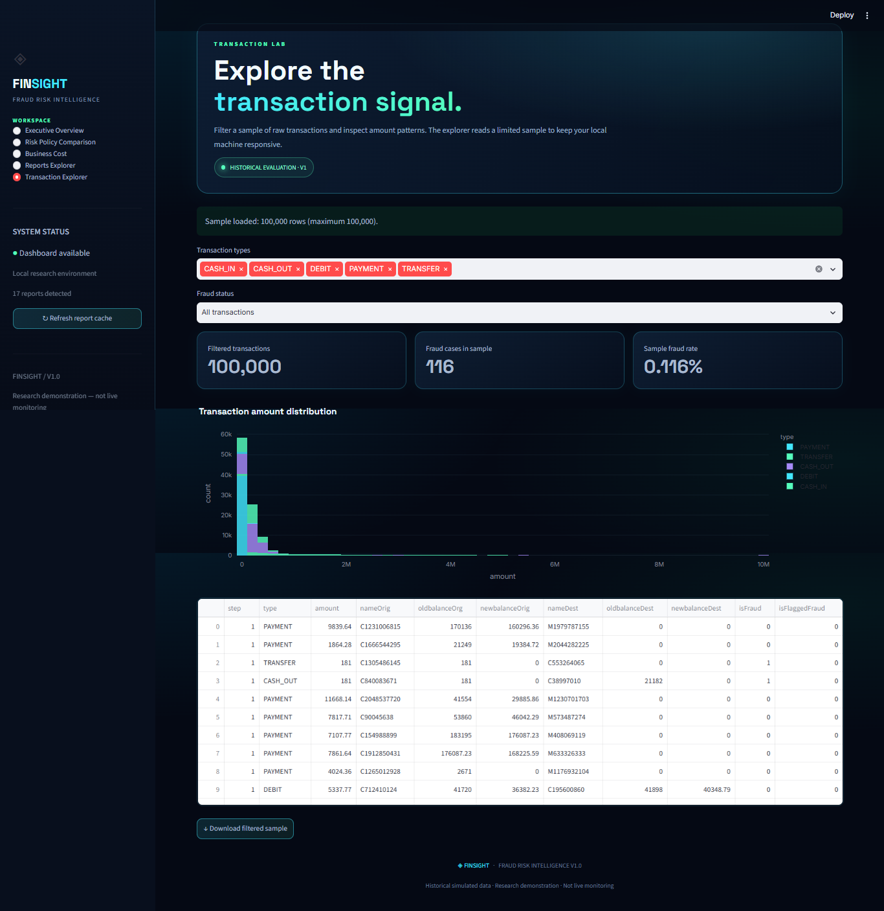
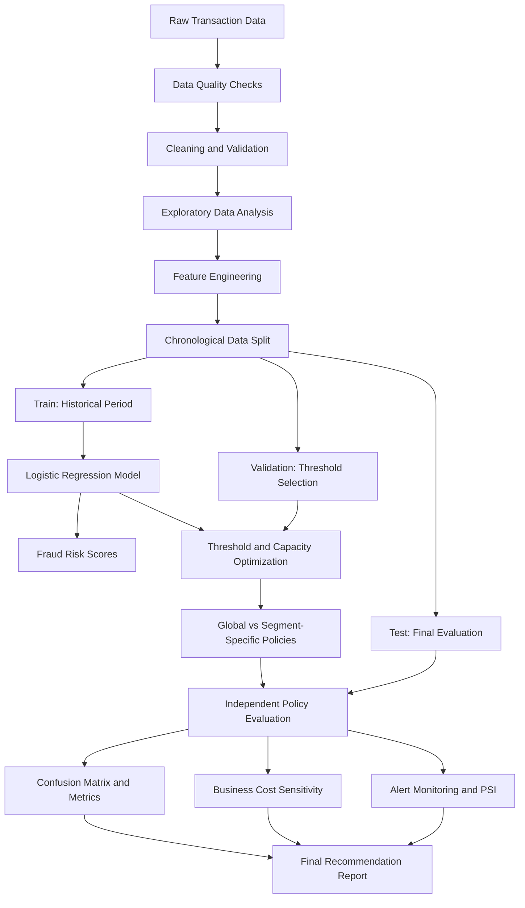

# FinTech Fraud Risk Intelligence System

### An End-to-End Machine Learning Pipeline for Transaction Fraud Detection, Risk Scoring, and Business-Aware Alert Optimization

[](https://github.com/Rauof-Qadir/fintech-fraud-risk-intelligence/actions/workflows/tests.yml)


**Repository:** [Rauof-Qadir/fintech-fraud-risk-intelligence](https://github.com/Rauof-Qadir/fintech-fraud-risk-intelligence)

A machine learning project focused on a practical financial-services problem: detecting suspicious transactions while balancing fraud coverage, false-positive alerts, investigation capacity, and estimated financial loss.

The project moves beyond model training to include data quality checks, feature engineering, chronological evaluation, threshold selection, risk-policy comparison, cost sensitivity analysis, score-drift monitoring, automated testing, and continuous integration.

> **Project objective:** Build an explainable, reproducible fraud-risk evaluation pipeline that helps investigate the trade-offs between detecting more fraud and keeping alert volumes operationally manageable.

---

## Screen Shots







## Table of Contents

- [Business Problem](#business-problem)
- [Project Highlights](#project-highlights)
- [System Architecture](#system-architecture)
- [Dataset](#dataset)
- [Methodology](#methodology)
- [Model Evaluation](#model-evaluation)
- [Risk Policy Comparison](#risk-policy-comparison)
- [Business Cost Analysis](#business-cost-analysis)
- [Monitoring and Drift](#monitoring-and-drift)
- [Project Structure](#project-structure)
- [Technology Stack](#technology-stack)
- [Getting Started](#getting-started)
- [Run the Pipeline](#run-the-pipeline)
- [Automated Testing and CI](#automated-testing-and-ci)
- [Reports](#reports)
- [Limitations and Responsible Use](#limitations-and-responsible-use)
- [Future Improvements](#future-improvements)
- [Author](#author)

---

## Business Problem

Financial institutions process large volumes of transactions, while fraudulent activity represents a small fraction of total transactions.

This creates three major challenges:

1. **Severe class imbalance:** A model can achieve high accuracy while failing to detect meaningful fraud.
2. **Investigation capacity:** Flagging too many legitimate transactions overwhelms fraud analysts and creates customer friction.
3. **Business trade-offs:** Missing fraud can create financial losses, but investigating false positives also consumes resources.

A useful fraud-risk system must therefore answer more than:

*How accurately can we classify a transaction?*

It must also answer:

- How many alerts will the fraud team receive?
- How many fraud cases might be missed?
- How does performance differ between transaction types?
- What happens when the cost of false positives changes?
- Does the score distribution change over time?
- Which assumptions need validation before operational deployment?

This project investigates these questions through a reproducible machine learning and policy-evaluation workflow.

## Project Highlights

- Analyzed a dataset containing **6.36 million transactions**.
- Built data quality and cleaning workflows.
- Engineered transaction-level features for fraud-risk scoring.
- Used chronological train, validation, and test periods.
- Developed a Logistic Regression baseline using pre-transaction features.
- Selected risk thresholds using validation data rather than tuning on the test set.
- Compared a global threshold against segment-specific policies.
- Evaluated precision, recall, false positives, missed fraud, and average precision.
- Estimated business costs under multiple assumptions.
- Implemented score-distribution drift monitoring using Population Stability Index (PSI).
- Added automated report-validation tests and GitHub Actions CI.

---

## System Architecture

The pipeline follows a modular structure so that data preparation, modeling, policy selection, and reporting can be maintained separately.



### Design principles

- **Separation of concerns:** Data preparation, modeling, policy evaluation, and reporting are implemented as separate modules.
- **Chronological validation:** Earlier transactions are used for training and later periods for evaluation.
- **Threshold discipline:** Validation data selects thresholds; test data evaluates the chosen policies.
- **Business-aware evaluation:** The system measures alert workload and estimated costs alongside model metrics.
- **Reproducibility:** Reports are saved as structured JSON or Markdown, and report integrity is tested automatically.

---

## Dataset

The project uses a PaySim-style financial transaction dataset.

| Property | Value |
|---|---:|
| Total transactions | 6,362,620 |
| Original columns | 11 |
| Labeled fraud transactions | 8,213 |
| Overall fraud prevalence | Approximately 0.129% |
| Missing cells reported | 0 |
| Exact duplicate rows reported | 0 |

### Original features

| Feature | Description |
|---|---|
| `step` | Simulation time step |
| `type` | Transaction type |
| `amount` | Transaction amount |
| `nameOrig` | Origin account identifier |
| `oldbalanceOrg` | Origin balance before transaction |
| `newbalanceOrig` | Origin balance after transaction |
| `nameDest` | Destination account identifier |
| `oldbalanceDest` | Destination balance before transaction |
| `newbalanceDest` | Destination balance after transaction |
| `isFraud` | Ground-truth fraud label |
| `isFlaggedFraud` | Existing system flag |

**Target variable:** `isFraud`

The existing `isFlaggedFraud` field is excluded from the model features to avoid using an existing flag as a shortcut for the prediction task.

The raw dataset is expected at:

`data/raw/transactions.csv`

Large raw data files may be excluded from Git. Dataset access and usage must comply with the original provider's terms.

---

## Methodology

### 1. Data Quality and Cleaning

The data-quality stage checks dataset dimensions, missing values, duplicates, column types, and suspicious records.

The purpose is to identify data issues before they affect downstream statistics and model results.

### 2. Exploratory Data Analysis

EDA investigates:

- Transaction-type distribution
- Fraud prevalence and class imbalance
- Transaction amount distributions
- High-value transaction behavior
- Differences between fraudulent and legitimate transactions

EDA findings help guide feature design and evaluation choices.

### 3. Feature Engineering

The temporal model uses features available before or at the transaction decision point.

| Feature | Purpose |
|---|---|
| `amount` | Transaction size |
| `oldbalanceOrg` | Origin account's prior balance |
| `oldbalanceDest` | Destination account's prior balance |
| `log_amount` | Reduces skew in transaction amounts |
| `is_zero_amount` | Flags zero-value transactions |
| `is_transfer_or_cashout` | Identifies selected transaction types |
| `type` | Categorical transaction information |

The log-transformed amount is calculated as:

`log_amount = log1p(max(amount, 0))`

Post-transaction balance fields are excluded from the temporal model because they may reveal information unavailable when a real-time decision is made.

This helps reduce potential temporal leakage, although feature availability and leakage risks should still be validated against the intended production environment.

### 4. Chronological Train, Validation, and Test Split

The temporal dataset is split by simulation step.

| Split | Step range | Transactions | Fraud cases |
|---|---|---:|---:|
| Train | 1–520 | 6,082,007 | 5,781 |
| Validation | 521–631 | 191,147 | 1,180 |
| Test | 632–743 | 89,466 | 1,252 |

The validation set is used to select thresholds and operating policies. The later test period is used to evaluate the selected choices.

The test period has a higher fraud prevalence than the training period. This is an important reminder that fraud patterns and class balance can change over time.

### 5. Model Training

The project uses **Logistic Regression** as a baseline risk-scoring model.

The model produces a fraud-risk score that can be compared with a selected decision threshold.

Logistic Regression provides a useful starting point because it is relatively lightweight and easier to inspect than many complex alternatives. Its predicted probabilities still require validation and should not automatically be interpreted as perfectly calibrated real-world fraud probabilities.

---

## Model Evaluation

The temporal model's global threshold was selected on validation data using illustrative business-cost assumptions.

### Global threshold: 0.19

On the held-out test period, for `CASH_OUT` and `TRANSFER` transactions combined:

| Metric | Result |
|---|---:|
| Transactions evaluated | 37,979 |
| Actual fraud cases | 1,252 |
| Alerts generated | 20,852 |
| True positives | 1,252 |
| False positives | 19,600 |
| False negatives | 0 |
| True negatives | 17,127 |
| Precision | Approximately 6.01% |
| Recall | 100% in this test period |

These results demonstrate a key fraud-detection trade-off: the selected global threshold detected all labeled fraud cases in this historical test period, but generated a large number of false-positive alerts.

**Important:** Zero missed fraud cases in one test period does not establish that future recall will be 100%.

---

## Risk Policy Comparison

The project also evaluates segment-specific thresholds selected on validation data under a target alert-capacity constraint.

For the 20% validation-capacity policy, the selected thresholds are approximately:

| Transaction type | Threshold | Validation alert rate |
|---|---:|---:|
| `CASH_OUT` | 0.4661 | 20.00% |
| `TRANSFER` | 0.8668 | 9.48% |

The target is a validation constraint, not a guarantee that the test or future alert rate will remain below 20%.

### Test-period comparison

| Metric | Global threshold | Segment-specific policy |
|---|---:|---:|
| Alerts | 20,852 | 7,104 |
| False positives | 19,600 | 5,878 |
| Fraud cases detected | 1,252 | 1,226 |
| Fraud cases missed | 0 | 26 |
| Overall precision | Approximately 6.01% | Approximately 17.26% |
| Overall recall | 100% in this test period | Approximately 97.92% |

The segment-specific policy substantially reduces alerts and improves precision in this test period, but it misses additional fraud cases.

This is not a simple winner-versus-loser comparison. The preferred policy depends on actual investigation capacity, fraud-loss economics, customer impact, and the organization's risk tolerance.

---

## Business Cost Analysis

To make the trade-offs explicit, the project uses illustrative cost assumptions:

- False-positive investigation cost: **$5 per alert**
- Missed-fraud loss: **100% of the missed transaction amount** in the full-loss scenario

Under these assumptions:

| Metric | Global threshold | Segment-specific policy |
|---|---:|---:|
| Estimated false-positive cost | $98,000.00 | $29,390.00 |
| Estimated missed-fraud loss | $0.00 | $2,681,809.26 |
| Estimated total cost | $98,000.00 | $2,711,199.26 |

These figures are scenario estimates, not measured bank costs or verified financial savings.

### Sensitivity analysis

The cost sensitivity analysis evaluates combinations of:

- False-positive handling cost: $5, $25, and $100
- Missed-fraud loss: 10%, 25%, 50%, and 100% of transaction amount

At a false-positive cost of $5, the estimated break-even loss fraction for the segment-specific policy is approximately **2.56%** of the combined amount of its missed fraud transactions, compared with the global policy's test results.

This break-even estimate depends on the specific test outcomes and assumptions. It is not a universal threshold for a financial institution.

The analysis highlights why fraud-policy selection should use verified loss and operational data rather than classification metrics alone.

---

## Monitoring and Drift

The project includes score-distribution monitoring using the Population Stability Index (PSI).

PSI compares the distribution of model scores between validation and test periods.

| Transaction type | PSI | Interpretation |
|---|---:|---|
| `CASH_OUT` | 0.0025 | Low score-distribution change |
| `TRANSFER` | 0.0224 | Low score-distribution change |

These values are below the commonly used 0.10 low-drift guideline.

However, **low PSI does not prove that fraud risk or model performance is stable**. In this experiment, fraud prevalence increased between validation and test periods even though score-distribution PSI remained low.

A production monitoring strategy should therefore track multiple signals:

- Score distributions and PSI
- Fraud prevalence and confirmed fraud outcomes
- Alert rate and investigation workload
- Precision and recall when labels become available
- False-positive and false-negative trends
- Changes by transaction type and relevant customer segments

Thresholds and monitoring limits should be approved by the business and reviewed periodically.

---

## Project Structure

The core implementation is organized into data, model, test, and report modules.

```text
fintech-fraud-risk-intelligence/
├── .github/
│   └── workflows/
│       └── tests.yml
├── data/
│   ├── raw/
│   │   └── transactions.csv
│   └── processed/
│       ├── transactions_clean.csv
│       └── temporal_splits/
│           ├── train.csv
│           ├── validation.csv
│           └── test.csv
├── models/
│   └── logistic_regression_temporal.joblib
├── reports/
│   ├── temporal_model_report.json
│   ├── risk_policy_comparison.json
│   ├── policy_business_cost.json
│   ├── policy_sensitivity_report.json
│   ├── alert_monitoring_report.json
│   ├── score_drift_psi_report.json
│   ├── final_policy_audit.json
│   ├── final_cost_sensitivity.json
│   └── final_policy_recommendation.md
├── src/
│   ├── data/
│   │   ├── quality.py
│   │   ├── cleaning.py
│   │   ├── eda.py
│   │   ├── features.py
│   │   └── temporal_split.py
│   └── models/
│       ├── baseline.py
│       ├── temporal_model.py
│       ├── alert_capacity_optimization.py
│       ├── risk_policy_comparison.py
│       ├── policy_business_cost.py
│       ├── policy_sensitivity_analysis.py
│       ├── alert_monitoring.py
│       ├── score_drift_psi.py
│       ├── final_policy_audit.py
│       ├── final_cost_sensitivity.py
│       └── final_policy_recommendation.py
├── tests/
│   └── test_final_reports.py
├── README.md
└── requirements.txt
```

*Note: This is a logical overview of the main project artifacts. Some files and generated data may be excluded from Git, and the repository may contain additional scripts.*

---

## Technology Stack

| Technology | Purpose |
|---|---|
| Python | Core implementation |
| pandas | Data preparation and analysis |
| NumPy | Numerical transformations |
| scikit-learn | Logistic Regression and model evaluation |
| Joblib | Model serialization |
| JSON | Machine-readable reports |
| pytest | Automated tests |
| Git and GitHub | Version control and collaboration |
| GitHub Actions | Continuous integration |

---

## Getting Started

### Prerequisites

- Python 3.12 recommended for matching the CI environment
- Git
- The transaction dataset available locally
- Sufficient disk space for the raw data, processed splits, and reports

### 1. Clone the repository

```bash
git clone https://github.com/Rauof-Qadir/fintech-fraud-risk-intelligence.git
cd fintech-fraud-risk-intelligence
```

### 2. Create a virtual environment

Windows PowerShell:

```powershell
py -3.12 -m venv .venv
.\.venv\Scripts\Activate.ps1
```

### 3. Install dependencies

```powershell
python -m pip install --upgrade pip
pip install -r requirements.txt
```

### 4. Prepare the dataset

Place the dataset at:

```text
data/raw/transactions.csv
```

Do not commit large raw datasets or sensitive financial data to a public repository.

---

## Run the Pipeline

The project is modular, so individual stages can be run and checked separately.

Example commands for the current implementation:

```powershell
python -m src.data.quality
python -m src.data.eda
python -m src.data.cleaning
python -m src.data.temporal_split
python -m src.models.temporal_model
python -m src.models.risk_policy_comparison
python -m src.models.policy_business_cost
python -m src.models.policy_sensitivity_analysis
python -m src.models.alert_monitoring
python -m src.models.score_drift_psi
python -m src.models.final_policy_audit
python -m src.models.final_cost_sensitivity
python -m src.models.final_policy_recommendation
```

Run these commands only after the required input data and earlier pipeline artifacts have been created.

The complete pipeline should be executed in dependency order. Some early modules may have dedicated runner scripts, so consult their source files if a module does not expose a `main()` entry point.

---

## Automated Testing and CI

The project includes automated checks for final policy reports.

Run the tests locally:

```powershell
python -m pytest tests/test_final_reports.py -v
```

The current report-validation test suite has **5 passing tests** in the local development environment.

The GitHub Actions workflow runs the report tests when code is pushed, a pull request is opened, or the workflow is manually triggered.

[View workflow runs](https://github.com/Rauof-Qadir/fintech-fraud-risk-intelligence/actions)

The workflow badge at the top of this README reflects the repository's actual GitHub Actions status.

---

## Reports

The following reports provide additional technical and business detail.

| Report | Purpose |
|---|---|
| [Temporal model report](reports/temporal_model_report.json) | Chronological model evaluation |
| [Risk policy comparison](reports/risk_policy_comparison.json) | Thresholds and alert-capacity trade-offs |
| [Business cost comparison](reports/policy_business_cost.json) | Estimated false-positive and missed-fraud costs |
| [Cost sensitivity analysis](reports/policy_sensitivity_report.json) | Alternative cost assumptions |
| [Alert monitoring](reports/alert_monitoring_report.json) | Score summaries and alert rates |
| [Score drift report](reports/score_drift_psi_report.json) | PSI-based score-distribution comparison |
| [Final policy audit](reports/final_policy_audit.json) | Segment-level and global-policy test results |
| [Final cost sensitivity](reports/final_cost_sensitivity.json) | Cost scenarios and break-even estimate |
| [Final policy recommendation](reports/final_policy_recommendation.md) | Business interpretation, limitations, and next steps |

These links work on GitHub when the corresponding files are committed to the repository.

---

## Limitations and Responsible Use

This project is a **research and portfolio prototype**, not a production-ready banking fraud prevention system.

Key limitations include:

1. **Synthetic or simulated data:** Results on a PaySim-style dataset may not generalize to real financial transactions.
2. **Historical evaluation:** A single test period cannot establish future performance.
3. **Illustrative costs:** Investigation costs and missed-fraud losses require validation using real business data.
4. **Probability calibration:** Predicted scores should not be treated as calibrated real-world fraud probabilities without further testing.
5. **Concept drift:** Fraud strategies and transaction distributions can change over time.
6. **Operational integration:** The project does not by itself provide a production-grade streaming ingestion system, case-management workflow, or approved transaction-blocking service.
7. **Fairness and customer impact:** Any real deployment would require governance, privacy protections, appropriate access controls, and evaluation of potential impacts on legitimate customers.

Any real-world use should involve fraud analysts, domain experts, risk owners, security reviews, and controlled validation before operational decisions are automated.

---

## Future Improvements

Potential next steps include:

- Benchmark Logistic Regression against tree-based models such as LightGBM or XGBoost.
- Evaluate calibration using reliability curves and Brier score.
- Add confidence intervals for key metrics and cost estimates.
- Improve threshold selection using verified investigation capacity and realized-loss data.
- Add temporal backtesting across multiple rolling windows.
- Monitor feature drift alongside score drift.
- Add explainability using feature coefficients and SHAP where appropriate.
- Build an analyst dashboard for reviewing risk scores and alerts.
- Add data and model versioning for reproducible experiments.
- Extend automated testing to data contracts, model artifacts, and pipeline integration.
- Explore streaming inference and a monitored API after the offline evaluation is validated.

---

## Author

**Rauof Qadir**

Software Engineer | Aspiring Data Scientist | FinTech Risk Analytics

Interested in machine learning, fraud detection, financial data science, and building practical data products.

- **GitHub:** [@Rauof-Qadir](https://github.com/Rauof-Qadir)
- **Project repository:** [FinTech Fraud Risk Intelligence System](https://github.com/Rauof-Qadir/fintech-fraud-risk-intelligence)

---

*Built as a hands-on project in data quality, machine learning, fraud-risk evaluation, business analytics, and reproducible engineering.*
